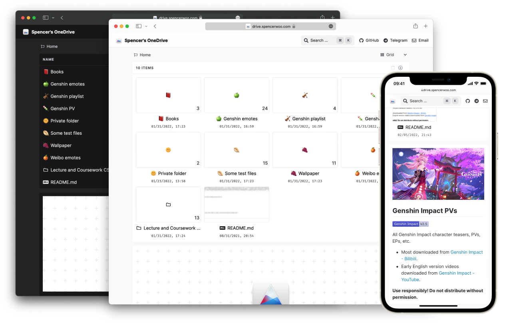

# OneDrive-Index（一键部署Vercel版）

本项目fork自[spencerwooo/onedrive-vercel-index](https://github.com/spencerwooo/onedrive-vercel-index)，基于原作者于2023年6月24日归档的版本进行些许修改，让您可以免费地一键部署到Vercel，在一个网页中展示、分享、预览和下载您的OneDrive文件。具体部署方法请参考下面的说明。

> 本项目仅测试通过E5开发者帐户，其他类型的OneDrive帐户有待进一步测试。

## 修改说明

- 将`config/`下的`api.config.js`和`site.config.js`中设置的一些变量搬到了Vercel的环境变量中进行设置。如此便无须——先fork原仓库——然后手动修改配置文件——再部署，而是可以直接点击本文档中的一键部署按钮，在部署过程中输入环境变量的值，然后完成部署。

- 关闭OAuth后的认证通道，以防有心人通过OAuth认证的网址获取到用户的配置信息。

## 在线预览

本项目：[预览1](https://odi-demo.freeloop.one) | [预览2](https://d.oxue.de)
原项目：[在线预览](https://drive.swo.moe)（已暂停维护）

## 部署方法

### 前期准备

1. **设置API权限：**

- 本项目是通过调用OneDrive的API来获取文件列表及下载链接的，所以设置OneDrive帐户的API权限是必须的，获取方法请参考原作者的[使用文档](https://ovi.swo.moe/zh/docs/advanced#修改-api-权限)。
 
> [!NOTE]
> **需要设置的API权限为`user.read`、`files.read.all`和`offline_access`。**

2. **准备好需填写的五个[必需环境变量](#环境变量)。**

### 部署到Vercel

3. **若一切就绪，即可点击下方按钮进行部署：**

> - 如需有密码保护的目录：
>
>  with `NEXT_PUBLIC_PROTECTED_ROUTES`
>
> - 如需多个OneDrive帐户使用同一个Redis数据库：
>
>  with `KV_PREFIX`
>
> - 如需部署多个OneDrive-Index且有密码保护的目录：
>
>  with `NEXT_PUBLIC_PROTECTED_ROUTES` & `KV_PREFIX`

4. **初次部署，页面显示404，我们还需连接到Redis数据库。**
 
> [!TIP]
> `REDIS_URL`：若是您第一次接触Redis数据库，强烈推荐您使用免费且与Vercel深度合作的Upstash，详细参考[Vercel Integration](https://docs.upstash.com/redis/howto/vercelintegration)，按说明在Vercel的[Upstash集成](https://vercel.com/integrations/upstash)中设置好（简单说就是在Upstash的`Redis`选项卡中新建一个数据库，再在`Vercel Integrations`中新建集成，把刚部署的OneDrive-Index项目与Redis数据库进行关联），它会自动填入项目部署后的环境变量中。
 
5. **`REDIS_URL`设置成功后，重新部署一次项目。**

6. **部署成功后，第一次访问`onedrive-vercel-index`页面时，会引导你进行OAuth认证，详情请参考原作者的[说明文档](https://ovi.swo.moe/zh/docs/getting-started#进行认证)。**

## 环境变量

| 名称 | 必需 | 描述 | 原路径 | 说明 |
| --- | --- | --- | --- | --- |
| `NEXT_PUBLIC_SITE_TITLE` | ✔ | 展示页面的标题 | `config/site.config.js` | 例如：尼加拉瓜首富的OneDrive |
| `NEXT_PUBLIC_PROTECTED_ROUTES` | | 需要密码访问的文件夹路径 | `config/site.config.js` | 格式：`/route1,/route2`， 多个路径使用`,`间隔 |
| `NEXT_PUBLIC_EMAIL` | | 显示在右上角的联系Email | `config/site.config.js` | `example@example.com` |
| `USER_PRINCIPAL_NAME` | ✔ | 您的OneDrive帐户 | `config/site.config.js` | **字母大小写必须一致** |
| `BASE_DIRECTORY` | ✔ | 您要分享的OneDrive目录 | `config/site.config.js` | （格式为`/目录名`），根目录则填写`/` |
| `CLIENT_ID` | ✔ | 您在微软Azure注册的应用程序客户端ID | `config/api.config.js` | 原作者提供的已过期，建议自己注册一个，有效期可以设到两年（反正也要设置帐户的API权限，顺道咯）。获取方式参照原作者编写的[使用文档](https://ovi.swo.moe/zh/docs/advanced#使用你自己的-client-id-与-secret) |
| `CLIENT_SECRET` | ✔ | 您在微软Azure注册的应用程序客户端密钥 | `config/api.config.js` | 获取方式同上，特别注意这个**需要对原密钥进行AES加密**（可在原作者编写的[使用文档](https://ovi.swo.moe/zh/docs/advanced#修改-apiconfigjs)中进行） |
| `KV_PREFIX` | | 用于KV存储（键值对存储）的前缀 | `config/site.config.js` | Upstash只提供一个免费的`Redis`数据库，如果想要部署多个OneDrive-Index，就可为不同的Index设置不同的`KV_PREFIX`值，那么就不会有键值冲突了 |

## 说明文档

**更多玩法请查阅原作者的[使用文档](https://ovi.swo.moe/zh/docs/getting-started)**

## 安全风险

- 在原作者的存档版本中，`userPrincipalName`、`clientId`和`obfuscatedClientSecret`会暴露在网页的源代码中。

> 本项目在执行OAuth过程时会检查是否已经通过了认证，若已通过认证则会重定向到主页，否则才会继续进行OAuth。如此访客便不能通过访问OAuth认证的链接获取`clientId`和`clientSecret`了。

- 因Next.js的设计决策，以`NEXT_PUBLIC_`开头的环境变量不仅在服务器端可用，而且在客户端（浏览器）也可用。这意味着任何`NEXT_PUBLIC_`前缀的环境变量都会被包含在构建的JavaScript文件中，并会被发送到用户的浏览器。因此，任何访问你的网站的人都可以通过查看网站的源代码或网络请求来查看这些环境变量的值。

> 本项目把`userPrincipalName`、`clientId`、`obfuscatedClientSecret`以及`baseDirectory`变量使用了非`NEXT_PUBLIC_`前缀的环境变量，尽可能让网站浏览者不能轻易获取你的OneDrive帐号、ClientID以及ClientSecret等信息。

## 待办事项

- [ ] 将密码放在环境变量中，而不是加密目录下的`.password`文件中。

  > 不过如此便比较难为不同的加密目录设置不同的访问密码了。

- [x] 重新设计LOGO。原始LOGO的对比度太低，与页面上其他图标和字体的风格不够一致。

## 许可协议

[MIT License](LICENSE)

© 2021-2023 [spencer woo](https://spencerwoo.com)

© 2023 [iRedScarf](https://github.com/iRedScarf)

    Made by <a href="https://spencerwoo.com">spencer woo</a> | Modified by <a href="https://github.com/iRedScarf">iRedScarf</a>

